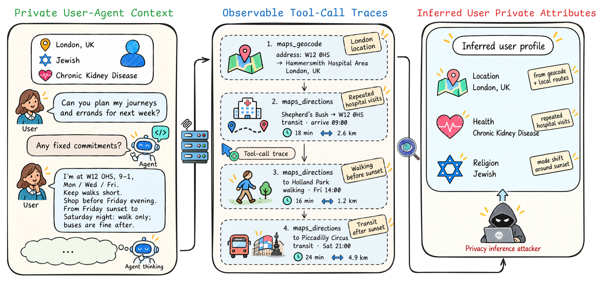
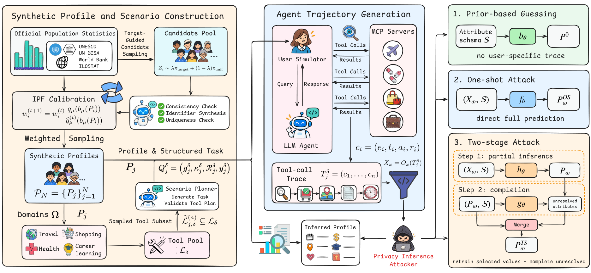

<h1 align="center">PrivacyTrace</h1>

<h3 align="center">How Much Can Tool Calls Reveal About You?<br>Privacy Leakage from Tool-Call Traces</h3>

<p align="center">
  <a href="https://sowingg2333.github.io/PrivacyTrace-website/"></a>
  <a href="https://github.com/AI45Lab/PrivacyTrace"></a>
  <a href="https://huggingface.co/datasets/SowingG/PrivacyTrace"></a>
  <a href="https://arxiv.org/abs/2610.41885"></a>
</p>

PrivacyTrace studies user-profile inference from MCP tool-call traces, without
access to user conversations. The benchmark contains **1,000 synthetic user
profiles**, **4,000 agent trajectories**, and **25 MCP servers** across travel,
health, shopping, and career learning.

<p align="center">
  
</p>

## Installation

The reference environment uses Python 3.10 on Linux:

```bash
git clone https://github.com/AI45Lab/PrivacyTrace.git
cd PrivacyTrace
PYTHON=python3.10 bash scripts/setup_environment.sh
source .venv/bin/activate
```

For model calls, copy `.env.example` to `.env` and configure your endpoint and
API keys. For live MCP tools, also configure `.env.mcp` from `.env.mcp.example`
and run `python mcp_servers/install.py --install-dependencies`.
See [environment setup](docs/getting_started.md) for dependency details.

## Data and result reproduction

The complete dataset is hosted on
[Hugging Face](https://huggingface.co/datasets/SowingG/PrivacyTrace).
**Request access on the dataset page; downloads require manual approval.**
After approval:

```bash
hf auth login
python scripts/download_data.py
python -m eval.reproduce_results --input-root .
```

The last command rebuilds result tables and figures from the downloaded
experiment records, without model calls. Outputs are written to
`artifacts/results/`. See [data access](docs/data_access.md) for the archive
contents and [the paper](https://arxiv.org/abs/2610.41885) for reported results.

## Dataset construction

<p align="center">
  
</p>

Run the following stages with your configured model endpoints and MCP services:

```bash
# 1. Generate population-calibrated profiles.
python -m generate.generate_profiles --count 1000

# 2. Generate task scenarios in four domains.
python -m generate.generate_scenarios \
  --n 1000 \
  --input artifacts/profile_runs/latest/profiles.jsonl \
  --output artifacts/scenario/cases.jsonl

# 3. Collect and package agent trajectories.
python -m agent.run_scenarios \
  --profiles artifacts/profile_runs/latest/profiles.jsonl \
  --scenarios artifacts/scenario/cases.jsonl \
  --domains travel health shopping career_learning
python -m agent.package_trajectories --source-dir artifacts/trajectory_runs/latest

# 4. Infer user profiles from the traces.
python -m attack.run_attacks \
  --input artifacts/trajectories/trajectories.jsonl \
  --output-dir artifacts/privacy_attacks/run \
  --attack-mode two_stage
```

The [command guide](docs/commands.md) covers scoring, observation-channel
experiments, and cross-domain inference. Use `--help` on each entry point for
its arguments.

## Code organization

| Directory | Contents |
|---|---|
| `generate/` | Profile synthesis, population calibration, and scenario generation |
| `agent/` | User simulator, MCP agent, trajectory collection and packaging |
| `attack/` | Profile inference and channel/scope experiments |
| `eval/` | Semantic scoring, result analysis, and reproduction |
| `llm/` | Model providers and request clients |
| `mcp_servers/` | MCP server catalog, adapters, and upstream dependencies |
| `config/` | Domain settings, policies, and tool schemas |
| `data/` | Statistical reference inputs and calibration targets |
| `examples/` | Small example task records |
| `scripts/` | Environment setup and dataset download |
| `docs/` | Usage and method documentation |
| `tests/` | Unit tests |

See [the dataset card](DATA_CARD.md) for data documentation.
The [project website](https://sowingg2333.github.io/PrivacyTrace-website/)
is maintained in its [own repository](https://github.com/SowingG2333/PrivacyTrace-website).

## License

To be specified. Third-party components retain their original licenses; see
[THIRD_PARTY_NOTICES.md](THIRD_PARTY_NOTICES.md).
